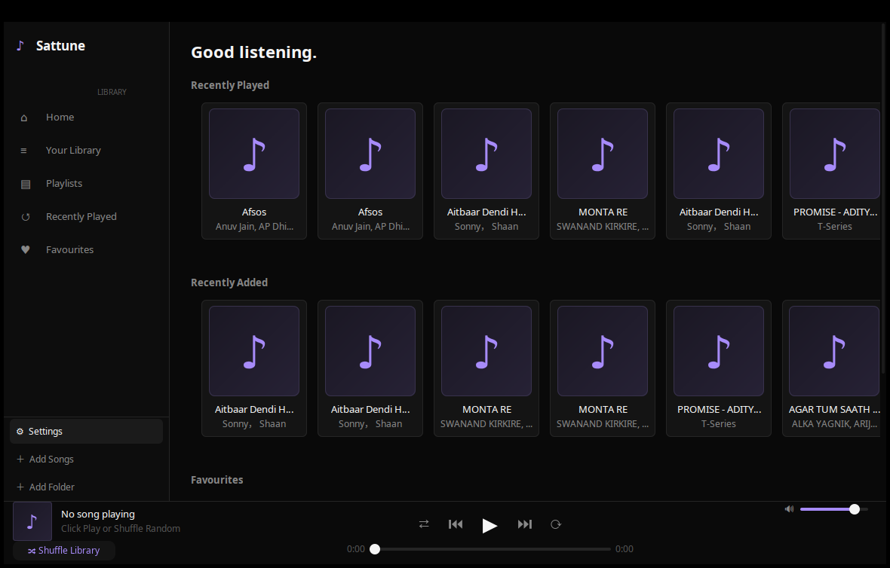

# Sattune 🎵

> *Just you, your music, and absolutely zero subscriptions begging for \$11.99/month.*

**Sattune** is a ridiculously fast, lightweight, and chill desktop music player built in Java Swing & FlatLaf. 

No algorithms telling you what to feel. No podcasts you never asked for shoved down your throat. No popups asking you to "Upgrade to Family Ultra HiFi Platinum". Just pure local music playback wrapped in a cozy, dark-themed, aesthetically pleasing interface.

---

## 📸 Behold the Vibes



*Dark theme (`#090909`), subtle lavender accents (`#A78BFA`), rounded cards, and zero visual clutter. Your eyes will thank you at 2:00 AM.*

---

## ☕ Why Sattune?

Modern music apps have basically turned into bloated social media platforms with a play button attached. They eat 800 MB of RAM, demand an internet connection to play files already sitting on your hard drive, and track your listening habits like an overattached ex.

Sattune does the exact opposite:
- 📴 **100% Offline**: Airplane mode? Power outage? Bunker life? Your tracks still play.
- 🪶 **Featherweight**: Sips ~25–40 MB of RAM. A single Chrome tab uses more memory just existing.
- 🚫 **No Tracking / No Telemetry**: We don't want your data. We don't even know what you're listening to. That guilty-pleasure 2000s boyband replay stays strictly between you and your headphones.
- ⚡ **Instant Launch**: Starts up before you can even take a sip of your coffee.

---

## ✨ Features That Actually Matter

- 🎧 **Plays Virtually Every Format You Throw at It**:
  - **MP3** (the trusty classic)
  - **M4A / AAC** (clean Apple audio)
  - **FLAC** (for the audiophiles who swear they can hear the drummer breathing)
  - **OGG Vorbis** (open-source bliss)
  - **WAV** (pure uncompressed goodness)
- 🕵️ **Format Detective (No Extension Trust Issues)**:
  - Renamed an MP3 to `.m4a` back in 2015 and forgot about it?
  - Sattune inspects real container magic bytes at the file level. If it's playable, it plays. No crashes, no judgment.
- 🔀 **Decision Paralysis? Just Shuffle**:
  - Hit the **"🔀 Shuffle Library"** button and let the universe pick the vibe.
- 📋 **Playlists That Actually Work**:
  - Create playlists, click **`＋ Add Songs`**, search your library, tick the checkboxes, and you're set.
  - Or right-click *any* track across the app to send it straight to a playlist.
- 🖼 **Embedded Artwork & Sleek Fallbacks**:
  - Extracts real high-res album covers on quiet background threads.
  - Got tracks without cover art? Sattune displays a classy, custom-designed dark gradient badge instead of an ugly missing image icon.
- 🔍 **Live Search**:
  - Filter by song title, artist, or album with instant, zero-lag results.
- 🧠 **Smart First Launch**:
  - Automatically peeks into your `~/Music` and `~/Downloads` folders on first boot so you don't have to hunt down files yourself.

---

## 🛠 Tech Stack

Built with timeless, battle-tested tech:

| Component | What powers it | Why it's cool |
| :--- | :--- | :--- |
| **Interface** | Java Swing + FlatLaf 3.4.1 | Custom dark curves, responsive shelves, zero web-view bloat |
| **Audio Core** | Java Sound API (`javax.sound.sampled`) | Direct DAC output, signed 16-bit little-endian PCM |
| **Decoders** | JLayer + MP3SPI + JAAD + jflac-codec + VorbisSPI | Pure Java SPI. No external binaries or heavy codecs required |
| **Tags & Art** | JAudioTagger 3.0.1 | Non-blocking background metadata & artwork extraction |
| **Storage** | Gson 2.10.1 | Simple human-readable JSON (`~/.local/share/SatTune/library.json`) |

---

## 🚀 Running Sattune

### Prerequisites
You just need **Java 17 or higher** installed.

### Quick Start
```bash
# 1. Grab the repository
git clone https://github.com/your-username/SatTune.git
cd SatTune

# 2. Build the shaded JAR
mvn clean package -DskipTests

# 3. Kick back and play your music
java -jar target/sattune-1.0.0.jar
```

Or just run the launch script:
```bash
chmod +x run.sh
./run.sh
```

---

## 📦 Cross-Platform Builds

Thanks to GitHub Actions and `jpackage`, you can build standalone native installers that bundle the Java runtime so your friends don't even need Java installed:

- **Windows**: `Sattune-1.0.0.exe` installer
- **macOS**: `Sattune-1.0.0.dmg` disk image
- **Linux**: `sattune_1.0.0_amd64.deb` Debian package or portable tarball

---

## 📂 Where's My Data?

Sattune keeps things clean. It never touches or moves your music files — it only stores playlists and settings in your standard OS user data folder:
- **Linux**: `~/.local/share/SatTune/library.json`
- **macOS**: `~/Library/Application Support/SatTune/library.json`
- **Windows**: `%APPDATA%\SatTune\library.json`

Want to reset everything? Just delete that JSON file and start fresh.

---

## 📄 License

Open-source under the [MIT License](LICENSE). 
Feel free to fork it, tweak the colors, play your tunes, and enjoy your day.

*"Sattune — Put on your headphones, tune out the world, and just chill."* 🎧✨
